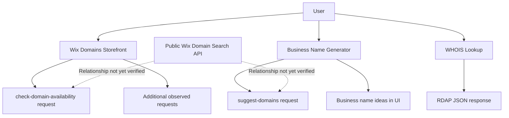

# Architecture

## 1. Overview

This document describes the observed architecture of three Wix domain discovery experiences:

1. Wix Domains Storefront
2. Business Name Generator
3. WHOIS Lookup

The investigation focused on browser-visible behavior and Network requests using Chrome DevTools.

The observations below are based on a limited manual investigation. They do not represent a complete view of Wix's internal architecture.

## 2. User-Facing Entry Points

### 2.1 Wix Domains Storefront

URL: https://www.wix.com/domains

The storefront allows users to search for a domain and check its availability.

**Observed test input:** `emilyclinic.com`

**Observed Network requests:**

- `check-domain-availability?domain=...`
- `emilyclinic.com?domainName=...`
- `query?...`

**Key observation – availability request:**

The `check-domain-availability` request returned HTTP `200 OK`.

The response contained:

```json
{
  "availability": {
    "domain": "emilyclinic.com",
    "available": false,
    "premium": false,
    "premiumType": "UNKNOWN_PREMIUM_TYPE"
  }
}
```

The UI displayed the domain as taken, which was consistent with the API response for this test.

**Additional observations:**

- Another request returned HTTP `404` with the error code `DOMAINS_NOT_FOUND`.
- The purpose of that request was not confirmed.
- The `query` request returned HTTP `200` with an empty `domainBrokerOffers` array.

These additional requests should not be interpreted as the primary availability result without further investigation.

### 2.2 Business Name Generator

URL: https://www.wix.com/tools/business-name-generator

The Business Name Generator helps users generate business name ideas and domain suggestions.

**Observed Network request:**

`suggest-domains?query=...`

**Observed HTTP status:** `200 OK`

**Response structure:**

- `suggestions`: An array of suggested domains.
- `domain`: The suggested domain name.
- `premium`: Indicates whether a suggestion is marked as premium.
- `pagingMetadata.count`: Number of suggestions in the response.
- `pagingMetadata.hasNext`: Indicates whether another page is available.
- `pagingMetadata.cursors.next`: Cursor for pagination.

**Observations:**

- The inspected response contained 50 domain suggestions.
- Suggestions included multiple TLDs, such as `.com`, `.net`, `.ai`, and `.co.il`.
- The first suggestion was `emilique.co.il`.
- All suggestions visible in the inspected response had `premium: false`.
- The response indicated that another page was available.

The UI also displayed business name ideas without domain extensions. This differs from the `suggest-domains` response, which contained complete domain names.

**Initial interpretation:**

The experience appears to include separate business-name ideas and domain suggestions. The exact relationship between these two processes was not confirmed.

Suggestions may vary between requests and locations. Automated tests should validate response structure rather than hardcode specific suggestion names.

### 2.3 WHOIS Lookup

URL: https://www.wix.com/domains/whois

The WHOIS page displays registration information for an existing domain.

**Observed test input:** `emilyclinic.com`

**Observed Network request name:** `EMILYCLINIC.COM`

**Observed response format:** JSON using the Registration Data Access Protocol (RDAP).

**Response fields observed:**

- `rdapConformance`: Supported RDAP specifications and profiles.
- `ldhName` and `unicodeName`: Domain name.
- `events`: Registration, update, and expiration dates.
- `nameservers`: Configured name servers.
- `status`: Domain status codes.
- `entities`: Registrar and contact roles.
- `redacted`: Fields removed or replaced according to privacy policies.

**Observations:**

The response included registration and expiration dates, registrar information, and nameservers.

Registrant, administrative, and technical contact information was partially redacted. The response explicitly included `REDACTED FOR PRIVACY`.

The information displayed by the WHOIS page was consistent with the registration information in the inspected RDAP response.

**Initial interpretation:**

The WHOIS experience uses an RDAP-based data source to retrieve domain registration information.

Privacy redaction is expected behavior and should not be reported as a defect.

## 3. Public API

Documentation:

https://dev.wix.com/docs/api-reference/account-level/domains/domain-search/introduction

The assignment also requires investigation of the public Wix Domain Search API.

The API investigation and its relationship to the three user-facing experiences have not yet been verified.

The following items require further investigation:

- Authentication requirements.
- Request and response structure.
- Domain availability behavior.
- TLD filtering.
- Error handling.

The public API should not be assumed to be the same backend service used by the storefront or Business Name Generator unless supported by network evidence.

## 4. Relationship Between the Entry Points

Based on the observations collected so far:

- The Wix Domains Storefront checks domain availability.
- The Business Name Generator returns business name ideas and domain suggestions.
- The WHOIS page retrieves domain registration information through an RDAP-based response.
- All three experiences help users investigate domain names, but they serve different purposes.

The observed requests do not yet establish whether these experiences share backend services or directly use the public Domain Search API.

Further investigation is required before drawing conclusions about shared services or dependencies.

## 5. Observed Network Summary

| Entry Point | Observed Request | Observed Result |
|---|---|---|
| Domains Storefront | `check-domain-availability?domain=...` | HTTP 200; `available: false` |
| Domains Storefront | `emilyclinic.com?domainName=...` | HTTP 404; `DOMAINS_NOT_FOUND` |
| Domains Storefront | `query?...` | HTTP 200; empty broker offers |
| Business Name Generator | `suggest-domains?query=...` | HTTP 200; 50 suggestions |
| WHOIS Lookup | `EMILYCLINIC.COM` | RDAP JSON response |

## 6. Architecture Diagram

The following diagram represents the observed user-facing flows. It does not claim that the pages share a backend or that the public API powers them.



## 7. Investigation Limitations

- The investigation used a limited number of manual test inputs.
- Network observations represent individual requests and may change over time.
- No conclusions about shared backend infrastructure have been established.
- The public Domain Search API still requires separate verification.
- Availability and domain suggestions are time- and location-dependent.
- WHOIS/RDAP data may contain privacy-redacted fields.